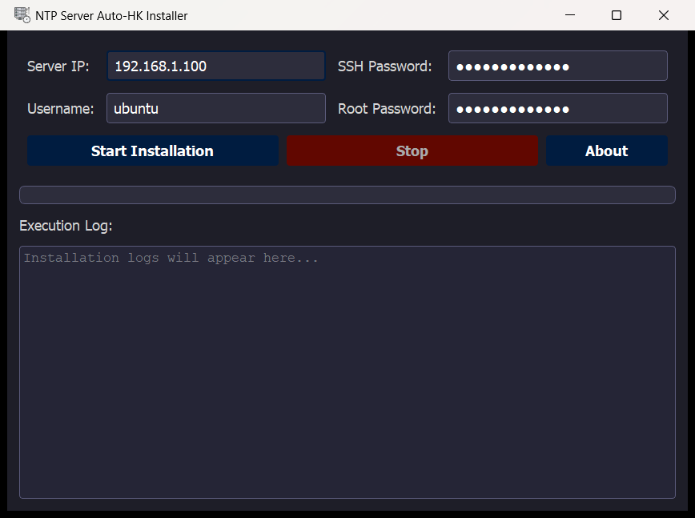
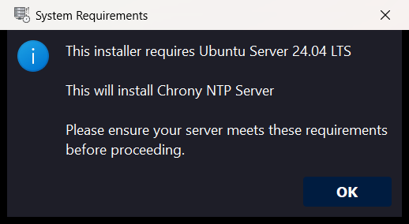

<h1 align="center">NTP Server Auto-HK Installer</h1>

<p align="center"><b>Turn an Ubuntu server into an NTP server over SSH</b></p>

<p align="center">
  
  
  
  <a href="https://github.com/alisadhk/ntp-server-auto-hk-installer/releases/latest"></a>
</p>

---

## Overview
A PyQt5 wizard that connects to a fresh Ubuntu server over SSH (paramiko) and installs and configures an NTP time server.

## Features
- One-click NTP server installation
- Live execution log with progress bar
- Stop button and installation summary
- Installs and configures **Chrony**, the modern NTP implementation
- Backs up the original chrony.conf before changing it
- Allows your clients to sync from the new server

## How it works
- The installer connects over SSH, updates the system and installs chrony.
- It copies /etc/chrony/chrony.conf to a .bak file, then edits the configuration so clients are allowed to query the server.
- It restarts the service and shows the sync status in the log.
- Configure your devices to use the server IP as their NTP server.

## Requirements
- Ubuntu/Debian server with SSH and sudo/root access.
- Outbound Internet on the server (apt and upstream NTP pools).
- Windows 10/11 for the installer GUI.

## Screenshots
<p align="center"></p>
<p align="center"></p>

## Download and install
### Option A - Ready-to-run download (recommended)
1. Open the **[Releases page](https://github.com/alisadhk/ntp-server-auto-hk-installer/releases/latest)**.
2. Download the file(s) listed under **Assets**:

| File | Size |
|---|---|
| `NTP-Server-Auto-HK-Installer.exe` | 41.8 MB |

3. Run it. 

### Option B - Run from source
Requirements: Windows 10/11 and Python 3.10+.

```bash
git clone https://github.com/alisadhk/ntp-server-auto-hk-installer.git
cd ntp-server-auto-hk-installer
python -m pip install -r requirements.txt
python 111.py
```

## How to use
1. Start the program. A **System Requirements** dialog appears first; read it and click **OK**.
2. Enter the **Server IP**, the SSH **Username** and **SSH Password**.
3. Enter the **Root Password** if the server needs it for sudo/root commands.
4. Press **Start Installation** and watch the **Execution Log**.
5. Press **Stop** to abort. When the log shows **Installation Complete**, use the access details printed in the log.

## Configuration and privacy
- All sensitive values from the original private version (passwords, tokens, license codes, user names, internal IP addresses, personal names and links) were replaced with `*****`.

## Troubleshooting
- Clients do not sync: open UDP 123 on the server firewall.
- Server shows no sync: check that it can reach the upstream NTP pool.
- Need the old settings: restore /etc/chrony/chrony.conf.bak.

## Build the executable yourself
```bash
python -m pip install pyinstaller
python -m PyInstaller --noconfirm 111.spec
```
The executable is created in the `dist/` folder.

## Notes
- Run it on Windows 10/11. The target server must be Ubuntu/Debian with SSH enabled.
- The tool needs the server's SSH user and password; use a dedicated account and change the password after installation.

---

<p align="center">Maintained by <a href="https://github.com/alisadhk">@alisadhk</a> - last update 2025-12-28</p>